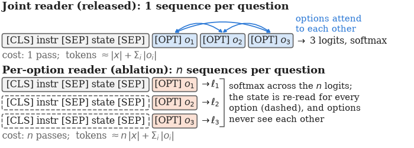
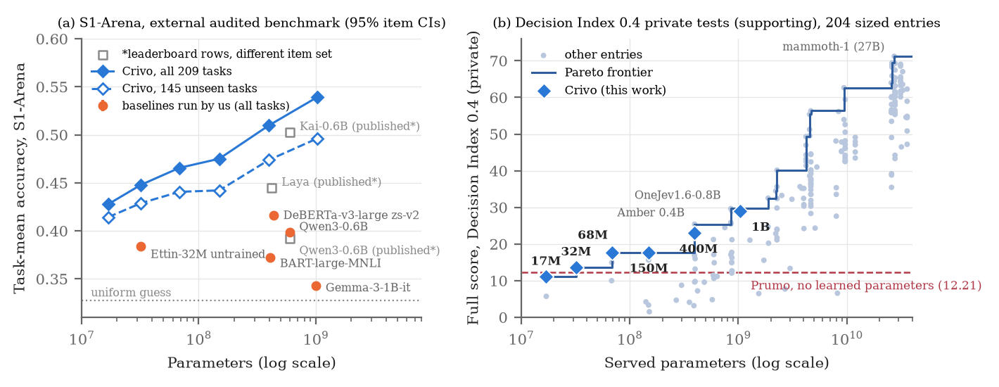

# Joint or Per-Option? Compact Encoders for Closed-Set Decisions from 17 Million to 1 Billion Parameters

[](LICENSE)
[](#citation)
[](https://huggingface.co/collections/tardellirs/crivo-6acaa1731d71f839970f04a6)
[](#installation)

Code, evaluation adapters and lightweight result files for the paper **"Joint or Per-Option? Compact Encoders for
Closed-Set Decisions from 17 Million to 1 Billion Parameters"** (Tardelli Stekel, 2026, in preparation).

Many language-model pipelines end in a closed-set decision: pick a tool, route a request, judge a claim. We ask how
small an encoder for such decisions can be, and whether it should read the candidate options **jointly** (all options
in one sequence, one pass) or **per option** (one sequence per option, n passes). In a controlled three-seed ablation
at 32M parameters, per-option scoring beats the joint reader by **5.8 points** of chance-corrected skill at matched
optimizer steps and by **2.8 points** at approximately matched training compute, at the cost of 5–13× more encoder
passes. Crossing reader with initialisation (three seeds per cell, matched compute) shows that this advantage appears
**only with the reranker initialisation**, whose (query, candidate) pair input matches per-option reading; from the raw
Ettin encoder the two readers are indistinguishable. We also release six joint encoders, **Crivo-17M to Crivo-1B**,
and evaluate them on overlap-audited external benchmarks (System1-Arena, BTZSC), for option-order robustness,
calibration and CPU/GPU latency. This repository holds everything needed to rerun those experiments and to regenerate
every table and figure of the paper from the shipped result files. The [experiment log](docs/EXPERIMENT_LOG.md)
records every run, including the decision rules written before each GPU run.

<p align="center">
  
</p>

## Contents

- [Key results](#key-results)
- [Models](#models)
- [Repository layout](#repository-layout)
- [Installation](#installation)
- [Quickstart](#quickstart)
- [Reproducing the experiments](#reproducing-the-experiments)
- [Regenerating the paper's tables and figures](#regenerating-the-papers-tables-and-figures)
- [Experiment log](#experiment-log)
- [Data and contamination policy](#data-and-contamination-policy)
- [Limitations](#limitations)
- [Citation](#citation)
- [License](#license)
- [Acknowledgments](#acknowledgments)

## Key results

All numbers are from the files in this repository. Brackets are 95% confidence intervals. "Unseen" means tasks or
datasets with no source-level or item-level overlap with the v2 training mixes (see
[Data and contamination policy](#data-and-contamination-policy)).

### A1: joint vs per-option reader (32M, 3 seeds per arm)

All arms share the encoder (`cross-encoder/ettin-reranker-32m-v1` init), tokenizer, `[OPT]` readout, loss
(CE + 0.5·Brier + distillation from Crivo-400M) and the same 150k training rows. Differences are P minus the joint
control, with Welch 95% CIs over seeds (3 + 3).

| Comparison | Public-suite skill (pub15) | S1-Arena acc (s1_60) | BTZSC macro-F1 (500/dataset) | Option-permutation flip rate |
|---|---|---|---|---|
| **P − J-steps** (matched optimizer steps) | **+0.058** [+0.050, +0.065] | +0.037 [+0.002, +0.073] | +0.116 [+0.056, +0.177] | −0.262 [−0.336, −0.188] |
| **P − J-comp** (approx. matched compute, pre-registered) | **+0.028** [+0.015, +0.042] | +0.031 [+0.010, +0.051] | +0.070 [+0.018, +0.121] | −0.253 [−0.275, −0.231] |

| Arm (mean of 3 seeds) | Reader | Optimizer steps | pub15 skill | S1 acc | BTZSC F1 | Flip (perm) |
|---|---|---:|---:|---:|---:|---:|
| J | joint | 2,112–2,114 | 0.180 | 0.406 | 0.425 | 0.277 |
| J-steps | joint | 6,842–6,843 | 0.187 | 0.417 | 0.485 | 0.262 |
| J-comp | joint | 6,858–6,860 (≈ 3.25 epochs) | 0.217 | 0.424 | 0.532 | 0.253 |
| **P** | per option | 6,853–6,860 † | **0.245** | **0.455** | **0.602** | **0** (by construction) |
| J-comp-raw (raw Ettin init, GPU-4) | joint | 6,858–6,860 | 0.226 | 0.416 | 0.459 | — ‡ |
| P-raw (raw Ettin init; seed 0 GPU-3, seeds 1–2 GPU-4) | per option | 6,858–6,860 | 0.214 | 0.419 | 0.478 | 0 |
| J-raw (raw Ettin init) | joint | 2,112–2,114 | 0.175 | 0.413 | 0.350 | 0.223 |

† P dropped 2 / 0 / 6 batches to CUDA OOM (seeds 0 / 1 / 2) of 6,858–6,860 planned steps; every other run
dropped none. ‡ GPU-4 ran no option-permutation (E4) evaluation.

### Initialisation × reader 2×2 (32M, 3 seeds per cell, matched compute)

GPU-4 completed the 2×2 of reader (joint / per option) × initialisation (`cross-encoder/ettin-reranker-32m-v1` /
raw `jhu-clsp/ettin-encoder-32m`): J-comp-raw is J-comp trained from the raw encoder (3 seeds) and P-raw gained
seeds 1–2. All four cells train for P's optimizer-step count per seed (6,858 / 6,860 / 6,859) on the same 150k rows,
with the same loss, LR schedule and evaluation. Means ± sd over 3 seeds:

| Initialisation | Joint, compute-matched | Per option |
|---|---|---|
| reranker | **J-comp**: skill 0.217 ± 0.006 · S1 0.424 ± 0.008 · BTZSC 0.532 ± 0.006 | **P**: skill 0.245 ± 0.003 · S1 0.455 ± 0.001 · BTZSC 0.602 ± 0.022 |
| raw Ettin encoder | **J-comp-raw**: skill 0.226 ± 0.013 · S1 0.416 ± 0.001 · BTZSC 0.459 ± 0.011 | **P-raw**: skill 0.214 ± 0.011 · S1 0.419 ± 0.004 · BTZSC 0.478 ± 0.014 |

Contrasts and reading rules were pre-registered before the run ([experiment log §18.y.1](docs/EXPERIMENT_LOG.md)).
Welch 95% CIs over seeds (3 vs 3; C4 with Welch–Satterthwaite df over the four cells); bold = CI excludes 0.

| Contrast | pub15 skill | S1 acc (s1_60) | BTZSC F1 (500/dataset) |
|---|---|---|---|
| **C1** (primary): P-raw − J-comp-raw, reader effect at raw init | −0.011 [−0.038, +0.015] | +0.003 [−0.007, +0.013] | +0.020 [−0.010, +0.050] |
| **C2**: P − P-raw, reranker gain for the per-option reader | **+0.031** [+0.006, +0.055] | **+0.036** [+0.026, +0.046] | **+0.123** [+0.077, +0.169] |
| **C3**: J-comp − J-comp-raw, reranker gain for the joint reader | −0.009 [−0.035, +0.017] | +0.007 [−0.013, +0.028] | **+0.073** [+0.051, +0.095] |
| **C4**: interaction C2 − C3 | **+0.040** [+0.014, +0.066] | **+0.028** [+0.011, +0.045] | **+0.050** [+0.006, +0.094] |
| P − J-comp, reader effect at reranker init (GPU-3, unchanged) | **+0.028** [+0.015, +0.042] | **+0.031** [+0.010, +0.051] | **+0.070** [+0.018, +0.121] |

From the raw encoder the two readers are indistinguishable at matched compute (C1 contains 0 on all three metrics),
and the interaction is above 0 on all three: the per-option advantage at 32M appears only with the reranker
initialisation. The reranker helps the per-option reader on every metric but the joint reader only on BTZSC. The most
direct reading is a format match (the Ettin rerankers were trained on query–document pairs, exactly the per-option
input); the 2×2 does not test that interpretation directly, and with three seeds per cell a small advantage of either
reader at raw initialisation is not excluded. Compute also matters at raw init (J-comp-raw − J-raw: +0.051
[+0.023, +0.079] skill, +0.109 [+0.086, +0.133] BTZSC F1). Every GPU-4 training ran its planned steps with 0 OOM
skips and every eval had 0 effective errors.

Files: [`results_gpu4/compare.txt`](results_gpu4/compare.txt) (with `compare.json`: all contrasts, the secondary
metrics and per-run training tokens), per-seed `results_gpu4/ev/*/*.score.json`, training logs in `results_gpu4/logs/`.

A2 (joint reader, minus J): removing the Brier term (+0.002 [−0.009, +0.012] skill), removing distillation
(−0.003 [−0.006, −0.000]) or starting from the raw encoder instead of the reranker (−0.005 [−0.014, +0.004]) changes
public-suite skill little at this scale; see `results_gpu2/summary.txt`.

Cost of reading per option (32M, same weights): 5.2–13.1× more forward sequences per request; on an A100 the median
request takes about the same time (10.7 vs 10.4 ms) but the mean is 4.3× (59.0 vs 13.7 ms) and p95 10× (329 vs 33 ms);
on 16 CPU threads the median is 1.9× and the mean 27×.

Files: [`results_gpu2/summary.txt`](results_gpu2/summary.txt), [`results_gpu2/P_vs_Jsteps.txt`](results_gpu2/P_vs_Jsteps.txt),
[`results_gpu3/compare.txt`](results_gpu3/compare.txt), [`results_gpu2/analysis/a1_analysis.md`](results_gpu2/analysis/a1_analysis.md)
(per-benchmark breakdown), [`results_gpu3/e6gpu/summary.txt`](results_gpu3/e6gpu/summary.txt).

### External benchmarks (released joint Crivo models)

**System1-Arena** (task-mean accuracy, the leaderboard statistic; 209 non-agentic tasks of the HF snapshot, 145 of them
unseen in training). Δ is Crivo − DeBERTa-v3-large-zeroshot-v2.0 (435M) with the per-item paired bootstrap CI.

| System | Params | All 209 tasks | Unseen 145 tasks | Δ vs DeBERTa, unseen [item CI] |
|---|---:|---:|---:|---|
| Crivo-17M | 17M | 0.428 | 0.414 | +0.000 [−0.007, +0.008] |
| Crivo-32M | 32M | 0.448 | 0.429 | +0.015 [+0.008, +0.022] |
| Crivo-68M | 68M | 0.466 | 0.441 | +0.027 [+0.020, +0.033] |
| Crivo-150M | 150M | 0.475 | 0.442 | +0.028 [+0.021, +0.035] |
| Crivo-400M | 400M | 0.510 | 0.474 | +0.060 [+0.053, +0.067] |
| Crivo-1B | 1B | **0.539** | **0.496** | +0.082 [+0.075, +0.089] |
| DeBERTa-v3-large zs-v2 (NLI) | 435M | 0.416 | 0.414 | — |
| Qwen3-0.6B (letter readout) | 0.6B | 0.398 | 0.402 | |
| BART-large-MNLI | 407M | 0.373 | 0.375 | |
| Ettin-32M reranker, untrained for this task | 32M | 0.384 | 0.388 | |
| Gemma-3-1B-it (letter readout) | 1B | 0.343 | 0.345 | |
| Uniform guess | — | 0.328 | 0.334 | |

The 68M and 150M margins over DeBERTa on unseen tasks also hold under a task-level bootstrap, but **not** for
question-pooled accuracy; the task mean is the benchmark's own statistic.

**BTZSC** (macro-F1, all 172,501 test items; only 4 of 22 datasets are unseen for the v2 family, so BTZSC is
secondary validation):

| System | Unseen-4 | All 22 |
|---|---:|---:|
| Crivo-17M / 32M / 68M | 0.469 / 0.514 / 0.553 | 0.513 / 0.603 / 0.667 |
| Crivo-150M / 400M / 1B | 0.564 / 0.636 / 0.686 | 0.671 / 0.699 / 0.751 |
| Qwen3-0.6B / Gemma-3-1B-it / raw Ettin-32M | 0.451 / 0.265 / 0.358 | 0.343 / 0.370 / 0.351 |
| DeBERTa-v3-large zs-v2 / ModernBERT-large zs-v2 † | 0.744 / 0.717 | 0.800 / 0.776 |

† Upper reference, not a zero-shot baseline: both zs-v2 models were fine-tuned on training splits of all 22 BTZSC
datasets with BTZSC's verbalizers ([`btzsc/zsv2_overlap.md`](btzsc/zsv2_overlap.md)).

Files: [`results_gpu/HEADLINE.md`](results_gpu/HEADLINE.md), [`stats/gpu1/gpu1_stats.md`](stats/gpu1/gpu1_stats.md),
`stats/gpu1/{s1,btzsc}.json`, per-system `results_gpu/{s1,btzsc}/*.score.json`.

### Robustness, latency and calibration

| System | Option-permutation flip rate (E4) | Median latency, A100 | Median latency, CPU 16 threads |
|---|---:|---:|---:|
| Crivo-17M | 23.1% | 8.2 ms | 13.5 ms |
| Crivo-32M | 19.6% | 10.5 ms | 21.9 ms |
| Crivo-68M | 15.6% | 17.6 ms | 53.2 ms |
| Crivo-150M | 16.6% | 19.8 ms | 97.3 ms |
| Crivo-400M | 16.5% | 24.1 ms | 253 ms |
| Crivo-1B | 11.8% | 24.3 ms | 579 ms |
| 32M per-option (ablation P) | 0% | 10.7 ms | 41.0 ms |
| DeBERTa-v3-large zs-v2 | 1.9% | 36.1 ms | 728 ms |
| Qwen3-0.6B / Gemma-3-1B-it (letter, no chat template) | 76.3% / 67.3% | — | — |

E4: 2,833 public-suite requests (3,841 `choice` questions, 34 benchmarks), three seeded permutations of the option
order. Latency: one request at a time; A100 over 1,000 fixed requests; CPU (AMD EPYC 7J13, 16 threads, GPU idle) over
the same 80 requests for every system. Means are dominated by a few very long requests; see the summaries.

Calibration (E5, public suite, benchmark-weighted ECE-15): every Crivo is over-confident in every confidence bin;
ECE grows from 0.076 (17M) to 0.158 (1B) while Brier and AURC improve with size. No temperature was fitted.

Files: [`stats/gpu1/e4.json`](stats/gpu1/e4.json), [`stats/gpu1/e6.json`](stats/gpu1/e6.json),
[`results_gpu3/e6cpu/summary.txt`](results_gpu3/e6cpu/summary.txt), [`e5/out/calib.json`](e5/out/calib.json),
[`e5/out/reliability.png`](e5/out/reliability.png).

### Decision Index (supporting)

<p align="center">
  
</p>

Board numbers are maintainer-run private tests from the snapshot of 2026-10-20 ([`board/`](board/)); they are not
recomputed here. Full score of Decision Index 0.4: 17M 11.11 · 32M 13.70 · 68M 17.69 · 150M 17.70 · 400M 22.96 ·
1B 28.96 (Prumo, no learned parameters: 12.21). Across all 208 board entries the public index correlates with the
private same-skill score at Pearson r = 0.981 [0.974, 0.986] ([`stats/board_stats.json`](stats/board_stats.json)).

## Models

Weights are **not** in this repository. They are released on the Hugging Face Hub under their own licenses.

| Model | Params | Reader | Hugging Face | License |
|---|---:|---|---|---|
| Crivo-17M | 17M | joint | [tardellirs/crivo-17m](https://huggingface.co/tardellirs/crivo-17m) | CC BY-NC 4.0 |
| Crivo-32M | 32M | joint | [tardellirs/crivo-32m](https://huggingface.co/tardellirs/crivo-32m) (v1 = revision `bbf3f19`) | CC BY-NC 4.0 |
| Crivo-68M | 68M | joint | [tardellirs/crivo-68m](https://huggingface.co/tardellirs/crivo-68m) | CC BY-NC 4.0 |
| Crivo-150M | 150M | joint | [tardellirs/crivo-150m](https://huggingface.co/tardellirs/crivo-150m) (v1 = revision `7a6c745`) | CC BY-NC 4.0 |
| Crivo-400M | 400M | joint | [tardellirs/crivo-400m](https://huggingface.co/tardellirs/crivo-400m) | CC BY-NC 4.0 |
| Crivo-1B | 1B | joint | [tardellirs/crivo-1b](https://huggingface.co/tardellirs/crivo-1b) | CC BY-NC 4.0 |
| Crivo-32M per-option ablation (arm P, seeds 0–2) | 32M | per option | [tardellirs/crivo-32m-per-option-ablation](https://huggingface.co/tardellirs/crivo-32m-per-option-ablation) | CC BY-NC 4.0 |
| Prumo (rule-based reference) | 0 learned | — | [tardellirs/prumo](https://huggingface.co/tardellirs/prumo) · [GitHub](https://github.com/tardellirs/prumo) | Apache-2.0 |

The public-suite run outputs of the released models are in the dataset
[tardellirs/decision-index-results](https://huggingface.co/datasets/tardellirs/decision-index-results).

## Repository layout

```
.
├── train/               training code vendored from the Crivo recipe (model.py, train.py, teach.py)
├── common/              baseline wrappers (engines.py), resumable runner (run_requests.py), batching check,
│                        contamination audit (contam.py, src_count.py)
├── btzsc/               E1: BTZSC adapter/scorer, harness-equivalence check, published baselines,
│                        contamination classes, zs-v2 training-overlap audit
├── s1arena/             E2: System1-Arena adapter (scores with the benchmark's own metrics), contamination classes
├── e4/                  E4: option-order perturbation set and flip-rate scorer
├── e5/                  E5: calibration on the public suite (extract, metrics, reliability figure, driver)
├── e6/                  E6: latency/memory runner
├── errors/              public-suite error analysis (+ the 68M hand-coded error sample: ids and categories only)
├── stats/               E7: board statistics, paired item-level bootstrap, official-scorer re-score check
├── a1a2/                A1/A2 grid: train_ablate.py, per-option engine (peropt.py), subset/eval-set builders,
│                        scorer, summaries, per-benchmark analysis, grid and eval scripts
├── gpu/                 GPU-1 (inference) and GPU-2 (grid) launch, setup and lane scripts
├── gpu3/                GPU-3: compute-matched control (Jcomp), Praw, E6 GPU/CPU latency; pre-registered compare.py
├── gpu4/                GPU-4: initialisation 2×2 of the reader ablation (JrawComp, Praw s1–s2); pre-registered compare.py
├── scripts/setup_vm.sh  CPU machine setup
├── audit_raw/           raw contamination audits, per-item hit lists (ids only), source counts
├── board/               Decision Index board snapshots of 2026-10-20 (third-party data, see NOTICE)
├── results_gpu/         GPU-1 result summaries: E1/E2 score files, E4 flips, E6 latency, HEADLINE.md
├── results_gpu2/        GPU-2 (A1/A2 grid) score files per arm and seed, training logs, summaries, A1 analysis
├── results_gpu3/        GPU-3 score files, training logs, compare.{txt,json}, E6 GPU/CPU latency, released-model subsets
├── results_gpu4/        GPU-4 (initialisation 2×2) score files per arm and seed, training logs, STATUS, compare.{txt,json}
├── results_cpu/         Prumo on BTZSC / S1-Arena / E4, earlier CPU latency runs
├── paper_artifacts/     make_tables.py and make_figs.py: every table and figure of the paper from the files above
└── docs/                EXPERIMENT_LOG.md (the experiment hand-off log) and the figures used in this README
```

Every result file states its provenance in the section that produced it; the chain is
`run_requests.py` output (not shipped, see below) → official scorer → `*.score.json` / `flips.json` → `stats/` →
`paper_artifacts/`.

## Installation

Python 3.12. The Crivo engine is pinned to **transformers 5.19.0**.

```bash
git clone https://github.com/tardellirs/crivo-decision-encoders.git
cd crivo-decision-encoders
uv venv --python 3.12 && source .venv/bin/activate     # or: python3.12 -m venv .venv && source .venv/bin/activate
uv pip install -r requirements.txt                      # or: pip install -r requirements.txt
# GPU: install the torch wheel that matches your driver first, e.g.
#   uv pip install torch --index-url https://download.pytorch.org/whl/cu128
```

Some experiments also need:

- the **Decision Index kit** with its frozen public suite (`suite-0.3`), from
  [apolinario/decision-index](https://github.com/apolinario/decision-index) (we used commit `9eb2dbe`); set
  `KIT=/path/to/decision-index` and `pip install -e $KIT --no-deps`. Needed for E4, E5, the pub15 eval set and Prumo;
- the benchmarks, downloaded from the Hub: `btzsc/btzsc` (test parquet) and `C-Tianyu/S1-Arena`, plus a clone of
  [TianyuCodings/S1-Arena](https://github.com/TianyuCodings/S1-Arena) for its scorer;
- `google/gemma-3-1b-it` is gated: export `HF_TOKEN` only if you run that baseline.

## Quickstart

**Run a released Crivo model on a request** (CPU is fine for the small models):

```python
import sys
from huggingface_hub import snapshot_download

path = snapshot_download("tardellirs/crivo-32m"); sys.path.insert(0, path)
from crivo import Crivo

model = Crivo(path)                                   # CUDA if available, else CPU
out = model.answer(
    state={"ticket": "My card was charged twice for the same order."},
    questions={
        "intent": {"type": "choice", "instructions": "What does the customer want?",
                   "criteria": {"refund": "Money back for the duplicate charge",
                                "cancel": "Cancel the order",
                                "info": "Just asking for information"}},
        "urgent": {"type": "noul", "instructions": "The customer needs a fast response."},
    })
print(out["intent"]["choice"], out["intent"]["probabilities"])
print(out["urgent"]["noul"])
```

**Run any system over a request file** (Decision Index wire format: one `{"id", "state", "questions"}` per line;
resumable, every answer validated):

```bash
python common/run_requests.py --engine crivo --opt path=tardellirs/crivo-17m --requests req.jsonl --out res.jsonl --batch 256
python common/run_requests.py --engine nli --opt model=MoritzLaurer/deberta-v3-large-zeroshot-v2.0 --requests req.jsonl --out res.jsonl
python common/run_requests.py --engine letter --opt model=Qwen/Qwen3-0.6B --requests req.jsonl --out res.jsonl --batch 16
```

**Run the per-option ablation checkpoint** ([tardellirs/crivo-32m-per-option-ablation](https://huggingface.co/tardellirs/crivo-32m-per-option-ablation),
three seeds). Its self-contained `peropt_engine.py` mirrors `a1a2/peropt.py`:

```bash
hf download tardellirs/crivo-32m-per-option-ablation --local-dir crivo-po
python crivo-po/peropt_engine.py --seed 0 --requests req.jsonl --out out.jsonl --batch 32
# or with this repository's engine (the one used for the paper's evaluation):
python common/run_requests.py --engine peropt:PerOptionEngine --opt path=crivo-po/seed0 --requests req.jsonl --out out.jsonl --batch 32
```

(`--engine peropt:...` needs `a1a2/` on `PYTHONPATH`: `export PYTHONPATH=$PWD/a1a2`.)

## Reproducing the experiments

Paths such as `~/req`, `~/results` and `~/evalsets` are the defaults of the remote scripts; every script documents its
environment variables in its header. Hardware, wall time and cost below are what we actually used.

| Experiment | Where it ran | Wall time | Cost |
|---|---|---|---|
| E1, E2, E4, E6-GPU (GPU-1) | 1× A100 SXM4 40 GB, 3 job lanes sharing the GPU, E6 alone | ≈ 12 h incl. reruns | ≈ US$24 (US$1.99/h) |
| A1/A2 grid (GPU-2): 6 arms × 3 seeds + evals | 1× A100 SXM4 40 GB | ≈ 6.3 h | ≈ US$12.6 |
| GPU-3: Jcomp ×3, Praw ×1, E6 GPU + CPU | 1× A100 SXM4 40 GB (CPU block on its 30-vCPU host) | ≈ 3.0 h | ≈ US$6 |
| GPU-4: JrawComp ×3, Praw ×2 (seeds 1–2) + evals | 1× A100 SXM4 40 GB | ≈ 3.2 h | ≈ US$6.4 |
| Contamination audit, Prumo runs, E5, error analysis | 16-vCPU cloud VMs | minutes per step (audit ≈ 4 min/pass, 15 workers) | — |
| E7 statistics, tables, figures | laptop CPU, < 0.6 GB RAM | ≤ 10 min per step | — |

Training the released models is not part of this budget (see the model cards).

### E1: BTZSC

```bash
python -c "from huggingface_hub import snapshot_download as s; s('btzsc/btzsc', repo_type='dataset', local_dir='data/btzsc')"
python btzsc/adapter.py requests --root data/btzsc --out req/btzsc_full.jsonl          # 172,501 requests; [--max_samples 500]
python common/run_requests.py --engine crivo --opt path=tardellirs/crivo-17m --requests req/btzsc_full.jsonl --out out/btzsc/crivo-17m.jsonl --batch 256
python btzsc/adapter.py score --requests req/btzsc_full.jsonl --results out/btzsc/crivo-17m.jsonl --out out/btzsc/crivo-17m.score.json
python btzsc/harness_check.py <crivo dir> data/btzsc 50 check.json                     # equality with the official harness
```

One fixed rendering for all 22 datasets (state = text; instructions = "Which label best describes the text?";
criteria = {label: BTZSC hypothesis}); macro-F1 exactly as the BTZSC harness (verified equal on all 22 datasets).
Published BTZSC baselines: `btzsc/published.py` → `btzsc/published_table.md`. All systems and options:
[`gpu/jobs_infer.tsv`](gpu/jobs_infer.tsv).

### E2: System1-Arena

```bash
python -c "from huggingface_hub import snapshot_download as s; s('C-Tianyu/S1-Arena', repo_type='dataset', local_dir='data/s1arena')"
git clone --depth 1 https://github.com/TianyuCodings/S1-Arena.git s1arena_code
python s1arena/adapter.py requests --data data/s1arena --out req/s1_all.jsonl             # 41,183 requests, 209 tasks
python common/run_requests.py --engine crivo --opt path=tardellirs/crivo-17m --requests req/s1_all.jsonl --out out/s1/crivo-17m.jsonl --batch 256
python s1arena/adapter.py score --data data/s1arena --code s1arena_code --requests req/s1_all.jsonl --results out/s1/crivo-17m.jsonl --out out/s1/crivo-17m.score.json
```

Scoring calls `s1arena.metrics.score` per task; overall = mean over the tasks of the 13 non-agentic domains.

### GPU-1 in one go (E1 + E2 + E4 + E6)

```bash
KIT=/path/to/decision-index bash gpu/launch.sh <user@host> infer     # pushes code + kit, runs gpu/setup_gpu.sh, starts tmux
# monitor ~/results/STATUS on the box; fetch with: rsync -a <user@host>:results/ results_gpu/
```

`gpu/run_lanes.sh` runs `gpu/jobs_infer.tsv` in 3 lanes, then `gpu/e6.sh` alone on the GPU, then `gpu/score_all.sh`.
`gpu/retry.sh`, `gpu/par.sh` and `gpu/finish.sh` are the exact recovery steps we used (OOM retries, E6 redo with the
GPU idle); only E6 rows listed in `results_gpu/logs/e6_redo.log` are reported.

### E4: option-order robustness

```bash
python e4/perturb.py sample --suite $KIT/suite-0.3 --out e4/e4_orig.jsonl              # 2,833 requests, 3,841 questions
python e4/perturb.py make --rows e4/e4_orig.jsonl --outdir e4/req                      # orig, perm1-3, rev, yn
# run each of the six files with run_requests.py into <dir>/<variant>.jsonl, then
python e4/perturb.py flips --rows e4/req/orig.jsonl --results <dir>
```

### E5: calibration and error analysis

```bash
RUNS=<dir with the nine public-suite runs> KIT=$KIT bash e5/run_vm.sh   # extract ≈ 1 min, calib ≈ 2 min, errors ≈ 2 min
python e5/plot_reliability.py e5/out/calib.json e5/out/reliability.pdf
```

The released runs are in [tardellirs/decision-index-results](https://huggingface.co/datasets/tardellirs/decision-index-results).

### E6: latency

```bash
python e6/latency.py --engine crivo --opt path=tardellirs/crivo-17m --requests lat1000.jsonl --threads 16 --limit 80 --per_request --out lat.json
python gpu3/e6_common.py --dir <dir with *.json and *.per.jsonl> --out summary.json   # same-subset statistics
```

`lat1000.jsonl` = the first 1,000 requests of a seed-7 shuffle of E4 `orig.jsonl` (built by `gpu/e6.sh`).

### E7: statistics

```bash
python stats/board_stats.py board/di-index-20261020.json board/di-index-v0.3.2-20261020.json stats/board_stats.json
python stats/stock_baselines.py board/di-index-20261020.json board/di-methodology-20261020.json stats/stock_baselines.md stats/stock_baselines.json
# item-level paired bootstrap; needs the request files with gold and the raw run outputs of E1/E2
python stats/paired_bootstrap.py extract --bench s1 --requests req/s1_all.jsonl --data data/s1arena --code s1arena_code --res results_gpu/s1 --out stats/gpu1/item/s1
python stats/paired_bootstrap.py s1 --res results_gpu/s1 --contam s1arena/contamination.json --items stats/gpu1/item/s1 --out stats/gpu1/s1.json
python stats/paired_bootstrap.py extract --bench btzsc --requests req/btzsc_full.jsonl --res results_gpu/btzsc --out stats/gpu1/item/btzsc
python stats/paired_bootstrap.py btzsc --res results_gpu/btzsc --contam btzsc/contamination.json --items stats/gpu1/item/btzsc --out stats/gpu1/btzsc.json
python stats/paired_bootstrap.py md --dir stats/gpu1                                    # -> stats/gpu1/gpu1_stats.md
```

Bootstrap: B = 2,000, seed 0; requests resampled within each task/dataset, the official statistic recomputed per draw.
`stats/rescore_check.py` re-scores a system through the official code paths (bit-identical to the score files).

### A1/A2 grid (GPU-2)

```bash
python a1a2/make_subset.py --train mix400_s1.train.jsonl.gz --teacher mix400_s1.t400.npz --n 150000 --seed 2026 \
    --out sub150k.jsonl.gz --out_teacher sub150k.t400.npz
python a1a2/build_eval.py --suite $KIT/suite-0.3 --btzsc data/btzsc --s1 data/s1arena --outdir evalsets   # pub15, btzsc500, s1_60
# one arm/seed (flags of every arm: a1a2/grid.tsv)
python a1a2/train_ablate.py --reader peropt --base cross-encoder/ettin-reranker-32m-v1 --train sub150k.jsonl.gz \
    --teacher sub150k.t400.npz --kd_gold_only "$(cat gold_only)" --epochs 1 --lr 1e-4 --head_lr 5e-4 --warmup 0.05 \
    --max_len 2048 --max_tokens 24576 --max_items 128 --grad_ckpt --seed 0 --out ck/P_s0
# whole grid on one A100 40 GB (what produced results_gpu2/):
KIT=$KIT DATA_DIR=<dir with the stage-1 data and teacher logits> bash gpu/launch.sh <user@host> grid
EVALDIR=evalsets python a1a2/summarize.py <grid results dir>   # -> summary.json / summary.txt (needs the raw eval outputs)
python a1a2/analyze_a1.py                       # per-benchmark A1 analysis (needs the raw eval outputs)
```

The grid ran with `a1a2/train_grid_serial3.sh` (one training at a time; the per-option arm with gradient
checkpointing), then `a1a2/jsteps.sh` (the step-matched J-steps arm) and `a1a2/eval_P.sh` (batched per-option
evaluation). Every training logs `oom_skips`; P dropped 2 / 0 / 6 of ≈ 6,860 batches (seeds 0 / 1 / 2), all other
runs 0. The training data and teacher logits are not distributed (see below).

### GPU-3: compute-matched control

```bash
KIT=$KIT INPUTS=<gpu3 inputs> S1_DATA=data/s1arena S1_CODE=s1arena_code P_S0=<P seed-0 checkpoint> \
  bash gpu3/launch.sh <user@host>            # then: ... status (every 10 min), ... fetch
python gpu3/compare.py --gpu2 results_gpu2 --gpu3 results_gpu3 --evaldir <evalsets> --out compare.json
```

The decision rule (P − J-comp, Welch 95% CI over seeds on four metrics) was written down before the run
([experiment log §18.1](docs/EXPERIMENT_LOG.md)) and implemented in `gpu3/compare.py`. J-comp is the J arm trained for P's
optimizer-step count per seed (6,858 / 6,860 / 6,859) with the LR schedule spanning exactly those steps. Input md5s: [`gpu3/inputs.md5.box`](gpu3/inputs.md5.box).

### GPU-4: initialisation 2×2

```bash
KIT=$KIT INPUTS=<gpu3 inputs> S1_DATA=data/s1arena S1_CODE=s1arena_code bash gpu4/launch.sh <user@host>   # then: ... status, ... fetch
python gpu4/compare.py --gpu2 results_gpu2 --gpu3 results_gpu3 --gpu4 results_gpu4 --out results_gpu4/compare.json
```

GPU-4 completes the reader × initialisation 2×2: JrawComp (joint reader from the raw Ettin encoder, compute-matched,
3 seeds) and Praw seeds 1–2, evaluated on pub15, btzsc500 and s1_60 (no E4, no latency). Its cells, contrasts
(primary: Praw − JrawComp) and reading rules were pre-registered in [experiment log §18.y.1](docs/EXPERIMENT_LOG.md)
before any run; `gpu4/run_gpu4.sh` runs the two Praw trainings alone, then the three JrawComp trainings with one eval
lane beside them. The run took ≈ 3.2 h on one A100 SXM4 40 GB (≈ US$6.4); results are in `results_gpu4/` and in
[Key results](#initialisation--reader-22-32m-3-seeds-per-cell-matched-compute). `compare.py` pools Praw seed 0 from
`results_gpu3/` with seeds 1–2 from `results_gpu4/`, and its P − J-comp line reproduces `results_gpu3/compare.txt`.
Run on the repository files, it reproduces `results_gpu4/compare.txt` except the per-run training lines, which read
the checkpoints' `config.json` (not distributed; the same counts are in `compare.json` and the training logs).

## Regenerating the paper's tables and figures

```bash
python paper_artifacts/make_tables.py            # -> build/tables/*.tex (LaTeX tables + number macros), stdlib only
python paper_artifacts/make_figs.py              # -> build/figs/*.pdf|png, needs matplotlib + numpy
```

Both read only files in this repository. We checked that `make_tables.py` reproduces every generated table and
number macro of the manuscript exactly.

## Experiment log

[`docs/EXPERIMENT_LOG.md`](docs/EXPERIMENT_LOG.md) is the hand-off log kept during the experiments (2026-10-20 to
2026-10-22), with its original section numbering: machines and provenance (§0), audits (§2–§3), adapters and baseline
wrappers (§5–§6), the A1/A2 grid design and its run (§7, §17), GPU-1 statistics (§16), E5 and error analysis (§13–§15),
the pre-registered GPU-3 and GPU-4 plans (§18.1, §18.y.1), the GPU-3 results (§18.x) and the GPU-4 results (the last
section, "18.y.2 GPU-4 results"). Host names, IP addresses, user names, instance ids and local paths were redacted;
the content is otherwise unchanged. Paths in it are relative to the original working directory, which corresponds to
the root of this repository.

## Data and contamination policy

- **No training or tuning on any test item.** One fixed request rendering per system for every dataset, chosen before
  any run. No temperature, threshold or prompt was fitted on test data.
- **What was audited.** Every BTZSC and S1-Arena test item was checked against every string field of every training
  row of each model family (v2 family: 17M, 32M v2, 68M, 150M v2, 400M, 1B; 32M v1; 150M v1), about 3.7M rows
  (`common/contam.py`): NFKC-normalised exact matches (≥ 5 words) and near-duplicates (≥ 80% of the item's word
  8-grams inside one training field). Source-level exposure was matched by dataset name (`btzsc/classify.py`,
  `s1arena/classify.py`).
- **Classes.** *seen-test-overlap* (overlap on ≥ 0.5% of the test items), *seen-train-split* (the source is in
  training, overlap below 0.5%), *unseen* (neither).
- **Outcome.** BTZSC: 4 of 22 datasets unseen for the v2 family (appreviews, empathetic, trueteacher, capsotu;
  18,852 items), so BTZSC is secondary validation. System1-Arena: 145 of 209 tasks unseen. Tables:
  [`btzsc/contamination.md`](btzsc/contamination.md), [`s1arena/contamination.md`](s1arena/contamination.md);
  per-item hit lists (ids only, for decontaminated re-scoring): `audit_raw/*_hits_allmixes.jsonl`.
- **Public suite.** The v2 family trains on the *train* splits of many Decision Index public-suite sources (never on
  their test items); public-suite numbers (A1/A2 pub15, E4, E5) are therefore in-distribution.
- **What is not in this repository**: training mixes and teacher logits, checkpoints, per-item raw model outputs and
  request files (they contain third-party benchmark text and are large), and the benchmark data itself. All of these
  can be regenerated with the scripts above from the public sources. The board snapshots in `board/` are third-party
  data reproduced unchanged for reproducibility (see [NOTICE](NOTICE)).

## Limitations

- The A1/A2 ablation is a **short regime**: 32M parameters, 150k rows, about one epoch (J-comp ≈ 3.25). The
  per-option reader was not trained at the full recipe's scale, and its advantage **depends on the reranker
  initialisation**: from the raw encoder the two readers are indistinguishable (initialisation 2×2, C1).
- **Seeds**: 3 per arm and per 2×2 cell; Welch intervals over 3 + 3 seeds are wide for BTZSC, and a small reader
  effect at raw initialisation is not excluded.
- **Compute matching is approximate**: J-comp and J-comp-raw match P in optimizer steps, schedule and per-step token
  budget, not exactly in encoded tokens (≈ 137M vs ≈ 161M for P / P-raw).
- **2×2 cells come from three GPU sessions** (GPU-2, -3, -4) with identical code, inputs (md5-checked), flags and
  scorers; a session effect cannot be separated.
- **Contamination**: only 4 BTZSC datasets are unseen for the v2 family; the S1-Arena audit is name-based at source
  level and conservative (longest state field) at item level. The S1-Arena HF snapshot lacks 2,043 local-only
  requests, so published leaderboard rows are not on the identical item set.
- **pub15 skill** (ablation metric) is not the official Decision Index; the board's private numbers are
  maintainer-run and cannot be recomputed here.
- **Baselines** use one fixed rendering each; the letter-readout LLMs run without a chat template (as BTZSC does) and
  may score below their own preferred prompts. NLI baselines truncate the premise to 512 tokens (BART 1,024).
- **Latency** is per request, one at a time, on one A100 and one cloud CPU; no CIs; means are dominated by a few very
  long requests.
- English only. The models are over-confident; treat probabilities as scores to threshold on your own data.

## Citation

```bibtex
@misc{stekel2026jointorperoption,
  title  = {Joint or Per-Option? Compact Encoders for Closed-Set Decisions from 17 Million to 1 Billion Parameters},
  author = {Tardelli Stekel},
  year   = {2026},
  note   = {In preparation}
}
```

See also [`CITATION.cff`](CITATION.cff).

## License

- **Code** in this repository: [Apache License 2.0](LICENSE).
- **Model weights** are released separately on the Hugging Face Hub under their own licenses: the Crivo models
  (including the per-option ablation checkpoint) are **CC BY-NC 4.0**; Prumo is Apache-2.0.
- **Third-party data** (benchmarks, board snapshots, and anything derived from them) keeps its own license and terms;
  see [NOTICE](NOTICE).

## Acknowledgments

- The `[OPT]` option-marker readout follows **Dinah-0**
  ([Lukitaduarte/dinah-0](https://huggingface.co/Lukitaduarte/dinah-0)).
- The encoders start from the **Ettin** encoders (Weller et al., *Seq vs Seq: An Open Suite of Paired Encoders and
  Decoders*) and the **Ettin reranker** family (Tom Aarsen,
  [cross-encoder/ettin-reranker-*](https://huggingface.co/blog/ettin-reranker)).
- **BTZSC** (Ilias Aarab; [btzsc/btzsc](https://huggingface.co/datasets/btzsc/btzsc),
  [IliasAarab/btzsc](https://github.com/IliasAarab/btzsc)) and **System1-Arena** (Tianyu Chen, Xinyang Liu, Ruyi An,
  Zhendong Wang, Mingyuan Zhou; [C-Tianyu/S1-Arena](https://huggingface.co/datasets/C-Tianyu/S1-Arena),
  [TianyuCodings/S1-Arena](https://github.com/TianyuCodings/S1-Arena)) for open data, code and scorers.
- The **Decision Index** maintainers for the reproduction kit
  ([apolinario/decision-index](https://github.com/apolinario/decision-index)) and the leaderboard
  ([multimodalart/jev-decision-index](https://huggingface.co/spaces/multimodalart/jev-decision-index)), including the
  private evaluations of the released models.
